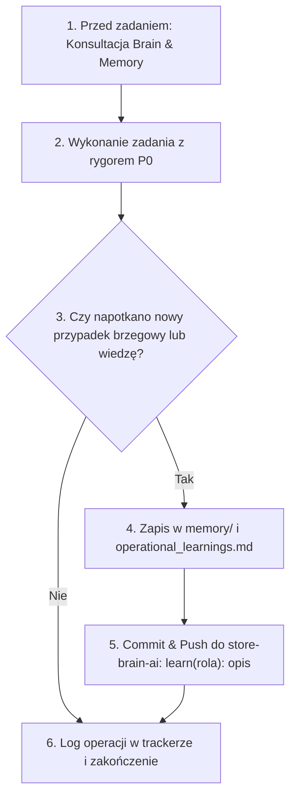

# Store Brain AI – Autonomous E-Commerce Operations & Knowledge Ecosystem

Centralne, wersjonowane repozytorium wiedzy, umiejętności agentowych oraz architektury samouczenia się dla sklepu **Natura Intimo** (`naturaintimo.com`) – marki oferującej europejską bieliznę full-bust (DD–M cups) bezpośrednio z Polski na rynki **USA, Kanady i Polski**.

---

## 🏛️ Architektura Repozytorium

```
store-brain-ai/
├── README.md                      # Główny przewodnik po architekturze Store Brain AI
├── AGENTS.md                      # Dyrektywy nadrzędne, zasady P0 oraz protokół samouczenia się
├── .gitignore                     # Rygorystyczna ochrona tajemnic (Zero Secrets P0)
│
├── .agents/
│   └── skills/                    # 21 wyspecjalizowanych umiejętności agentowych
│       ├── store-manager-sms/     # Nadzór nad katalogiem WooCommerce, MADA XML, rozmiary EU/US
│       ├── ecommerce-ceo-sms/     # Strategia 0 PLN Organic First, marża po DDP, koordynacja zespołu
│       ├── growth-marketing-ai-seo-sms/ # Multi-channel marketing, SEO, Google Merchant, GEO /llms.txt
│       ├── marketing-director-sms/# Harmonogramowanie kampanii i weryfikacja publikacji
│       ├── accounting-export-customs-sms/ # KSeF FA(3), IE-599 0% VAT, DHL Commercial Invoice, CETA, HTS
│       ├── brafitting-customer-care-sms/  # Konsultacje rozmiarowe EU↔US, sister sizes, RMA 30 dni, opinie FTC
│       ├── tech-ux-security-sms/  # Snippety PHP, routing /en/, optymalizacja, WCAG 2.2 AA, API security
│       ├── us-ca-compliance-auditor-sms/  # FTC Act, California SB 478, Bill 96, Competition Act
│       ├── hook-writer-sms/       # Generowanie angażujących pierwszych zdań i nagłówków
│       ├── caption-writer-sms/    # Precyzyjny copywriting do postów i rolek
│       ├── post-writer-sms/       # Generowanie postów wieloplatformowych
│       ├── thread-writer-sms/     # Dłuższe serie i wątki narracyjne
│       ├── content-strategy-sms/  # Filary treści i architektura tematów
│       ├── content-calendar-sms/  # Kalendarz postów i kadencja publikacji
│       ├── content-pattern-analyzer-sms/ # Identyfikacja zwycięskich wzorców zaangażowania
│       ├── content-repurposer-sms/# Recykling i adaptacja treści między platformami
│       ├── performance-analyzer-sms/ # Analityka wyświetleń i konwersji
│       ├── optimization-advisor-sms/ # Działania optymalizacyjne o najwyższym ROI
│       ├── audience-growth-tracker-sms/ # Śledzenie przyrostu zaangażowanej widowni
│       ├── social-media-context-sms/ # Kontekst marki i profil odbiorcy
│       └── platform-strategy-sms/ # Taktyki per platforma (IG, FB, TikTok, Pinterest)
│
├── brain/                         # Centrum Wiedzy i Jedno Źródło Prawdy (Single Source of Truth)
│   ├── single_source_of_truth/
│   │   ├── market_config.json     # P0: Oficjalne progi darmowej dostawy, stawki DHL DDP, maile, zwroty
│   │   ├── brand_identity.json    # Wytyczne marki, USP, ton głosu, czarna lista zakazanych twierdzeń
│   │   └── size_conversion_matrix.json # Matryce przeliczania obwodów (cm↔cale) i miseczek (EU↔US/UK)
│   ├── ai_seo/
│   │   ├── llms.txt               # GEO (Generative Engine Optimization) – zwięzła specyfikacja dla LLM
│   │   └── llms-full.txt          # Pełna baza ustrukturyzowanej wiedzy dla wyszukiwarek AI
│   └── agent_guidebooks/          # Podręczniki operacyjne per rola (CEO, Merchant, CMO, Tech Lead itp.)
│       ├── ceo.md
│       ├── merchant.md
│       ├── cmo.md
│       ├── accountant.md
│       ├── customer_care.md
│       ├── tech_lead.md
│       └── compliance.md
│
├── memory/                        # Ciągłe Samouczenie Się Agentów (Continuous Self-Learning)
│   ├── operational_learnings.md   # Dziennik wniosków operacyjnych, rozwiązane problemy i zasady
│   ├── brafitting_edge_cases.json # Niuanse dopasowania per marka (Gorsenia, Gaia, Ava, Alles)
│   ├── customs_and_tax_rulings.json # Kody celne HTS, reguły preferencyjne CETA, progi nexus
│   ├── audience_insights.json     # Przetestowane punkty bólu klientek z USA i skuteczne formaty treści
│   └── operational_tracker.json   # Rejestr kamieni milowych i operacji na żywym sklepie
│
└── backend/                       # Kluczowe silniki, potoki i snippety wykonawcze
    ├── mada_usa_sync_pipeline.py  # Synchronizacja wariantów i stanów z hurtowni MADA
    ├── social_media_analytics_engine.py # Monitorowanie metryk Meta Graph API
    ├── publish_corrected_posts.py # Bezpieczna publikacja postów z weryfikacją cen
    ├── order_fulfillment_mada_manager.js # Automatyzacja zamówień i powiadomień
    └── snippet_14_enhanced.php    # Wdrożony i zoptymalizowany snippet doładowania koszyka
```

---

## 🧠 Zespół Autonomicznych Agentów

| Agent | Skill | Kluczowa Rola |
| :--- | :--- | :--- |
| **Prezes Przedsięwzięcia (CEO)** | `ecommerce-ceo-sms` | Nadzór nad rentownością 0 PLN Organic First, marża po cle DDP, zarządzanie zespołem. |
| **Kierownik Sklepu (Merchant)** | `store-manager-sms` | Synchronizacja wariantów MADA, rygor składu włókien FTC, stany magazynowe. |
| **Dyrektor Marketingu & CMO** | `growth-marketing-ai-seo-sms` | Organiczny ruch z Instagrama, TikToka, FB, Pinteresta, Google Merchant, Schema.org i GEO (`/llms.txt`). |
| **Księgowy & Eksport** | `accounting-export-customs-sms` | KSeF FA(3), kursy NBP, 0% VAT eksport (IE-599), Commercial Invoice DHL, kody HTS, CETA. |
| **Brafitterka & Obsługa Klienta** | `brafitting-customer-care-sms` | Konsultacje rozmiarowe EU↔US, dobór *sister sizes*, SLA <24h, obsługa zwrotów RMA 30 dni. |
| **Inżynier Sklepu & UX (Tech Lead)** | `tech-ux-security-sms` | Snippety PHP, ochrona przed psuciem skryptów przez `wpautop`, szybkość Core Web Vitals, bezpieczeństwo API. |
| **Strażnik Compliance** | `us-ca-compliance-auditor-sms` | FTC truth-in-advertising, California SB 478 (Honest Pricing), kanadyjski zakaz Drip Pricing, ochrona znaków towarowych. |

---

## 🔄 Protokół Ciągłego Samouczenia Się (Self-Learning Loop)

Wszyscy agenci pracują w dynamicznej pętli uczenia się i aktualizowania repozytorium:



1. **Konsultacja Bazy Przed Rozpoczęciem Zadania:**
   Zanim agent podejmie decyzję (np. o doborze rozmiaru, wycenie wysyłki czy kodzie HTS), odczytuje odpowiednie pliki z `brain/` oraz `memory/`.
2. **Ekstrakcja Doświadczenia Po Zadaniu:**
   Jeśli w trakcie operacji na żywym sklepie, kontakcie z klientem lub kampanii agent rozwiąże problem lub odkryje nową zależność (np. zachowanie miseczki Gorsenia, interpretację celną HTS czy błąd wariantu), zapisuje ten fakt w `memory/operational_learnings.md` lub w dedykowanych plikach JSON (`brafitting_edge_cases.json`, `customs_and_tax_rulings.json`, `audience_insights.json`).
3. **Wersjonowanie Wiedzy (Git Sync):**
   Agent wykonuje commit oznaczony prefiksem `learn(<rola>): <opis>` i synchronizuje wiedzę z repozytorium GitHub, dzięki czemu następny agent w kolejnej sesji natychmiast posiada tę wiedzę.

---

## 🛡️ Zasada P0: Zero Hardcoded Secrets

* **Absolutny brak haseł i kluczy w repozytorium:** Żadne hasła aplikacji WordPress, klucze WooCommerce, tokeny Meta, tokeny KSeF, klucze API ani tokeny GitHub nie mogą znaleźć się w commitach.
* Wszystkie wrażliwe dane są pobierane w runtime wyłącznie z lokalnego pliku `.env` (ściśle ignorowanego przez `.gitignore`).
* Każdy plik przed wysłaniem przechodzi zautomatyzowany skan bezpieczeństwa.

---

## 🚀 Jak Agenci Używają Repozytorium

1. **Pobieranie wiedzy:** Przed rozpoczęciem sesji agent wykonuje `git pull origin main` lub bezpośrednio czyta pliki z `brain/` i `memory/`.
2. **Jedno Źródło Prawdy:** Zmiany parametrów biznesowych wprowadza się wyłącznie w `brain/single_source_of_truth/market_config.json`, skąd wszystkie skrypty i podstrony pobierają dane.
3. **Ciągły rozwój:** Każdy agent czyni repozytorium mądrzejszym z każdym zrealizowanym zadaniem.
